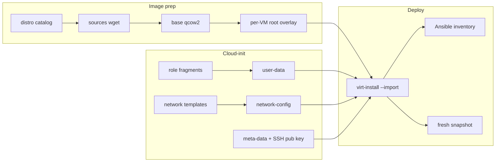

# Autobuild architecture

## What it is

**autobuild** is homelab infrastructure automation: a **GNU Makefile**, **cloud-init template trees**, and small shell helpers—not a long-running service. Behavior is defined by Make targets, `sed` assembly of templates, and libvirt CLI calls.

## VM creation flow

1. **`distro`** — Each line: `name;version;url;filename`. `DISTRO` selects the Ubuntu cloud image.

2. **`sources` → `base` → `image`** — Download into `$(VARDIR)/sources`, copy to shared `$(VARDIR)/base/<distro>/rootfs.qcow2`, then `qemu-img create -b …` for `$(VARDIR)/images/<shortname>/rootfs.qcow2`.

3. **Extra disks** — When `SWAPSIZE`, `DATASIZE`, `DBSIZE`, `DBLOGSIZE`, or `WEBSIZE` are non-zero, matching qcow2 files are created (data under `$(DATADIR)/<shortname>/`).

4. **`role`** — Start from `user-data-dir/<DISTRO>/user-data.tmpl` (or `-proxy.tmpl`). Insert role files at markers:
   - `packages-dir/<DISTRO>/packages-<ROLE>`
   - `bootcmd-dir/.../bootcmd-<ROLE>.tmpl`
   - `mounts-dir/...`, `runcmd-dir/...`, `apt-dir/...`
   - `pubkeys/keys` at `#SSHKEYS`

5. **`network-config`** — `NET=static` requires `IPADDRESS` from `getent hosts <shortname>`. Templates live under `network-config/<DISTRO>/`.

6. **`meta-data`** — instance-id (uuidgen), `role`, `aenv`, `grpname`, hostname, SSH public key; copies assembled `user-data` beside it for virt-install.

7. **`node`** — `virt-install --connect qemu:///system … --import --cloud-init …`. If `ANSIBLE=true`, runs `./update-ansible`, copies inventory to `ansible@ansible`, `sshreset`, starts domain, snapshot `fresh`.

## Delete and backup

- **`Delete`** — `virsh destroy`, drop snapshots, `undefine --remove-all-storage`, destroy/undefine pools `<shortname>` and `<shortname>-1`, remove image/data dirs, prune Ansible, `clean-image`.
- **`backup`** — dumpxml, shutdown, tar disk paths from XML via `bin/get-src-file`.
- **`restore`** — `Delete`, extract tarball to `/`, `virsh define`, start.
- **`live-backup`** — `virsh backup-begin`.

## Configuration surface

Important Makefile defaults (override with `make -e VAR=value`):

- `VARDIR=/var/lib/libvirt`, `DATADIR=/var/lib/libvirt/data`
- `DOMAIN=.tsand.org` (FQDN convention; short name = first label of `NAME`)
- `GRPNAME` — `NAME` with `.` → `-` for cloud-init group
- `ARCH=x86_64` (optional `aarch64` + `noblearm` distro)

Host-specific integration: `ansible@ansible`, `/etc/ansible/hosts` group `[virt]`, proxy templates when `PROXY=true`.

## UIs

| UI | Entry | Behavior |
|----|--------|----------|
| Qt | `make gui` → `autobuild_gui.py` | Auth via `.auth.json`; spawns `make node` / `make Delete`; logs under `logs/` |
| Web | `make web-ui-server` | `web-ui/server.js` POST `/api/node`, `/api/delete`; cwd = repo root |

GUI and web role dropdowns are **not exhaustive**; any `ROLE` with fragments under `packages-dir/<DISTRO>/` works from the CLI.

## Related repos / files

- **`tools/Makefile`** — TLS/certificate helpers, separate from VM build.
- **`setup`** — Large captured output file, not an install script.
- **Gluster / HA scripts** at repo root — operational helpers, not invoked by `make node`.

## One-liner

autobuild is a **Make + cloud-init + qcow2 overlay** pipeline that turns Ubuntu cloud images into role-tuned KVM guests with optional Ansible registration.
